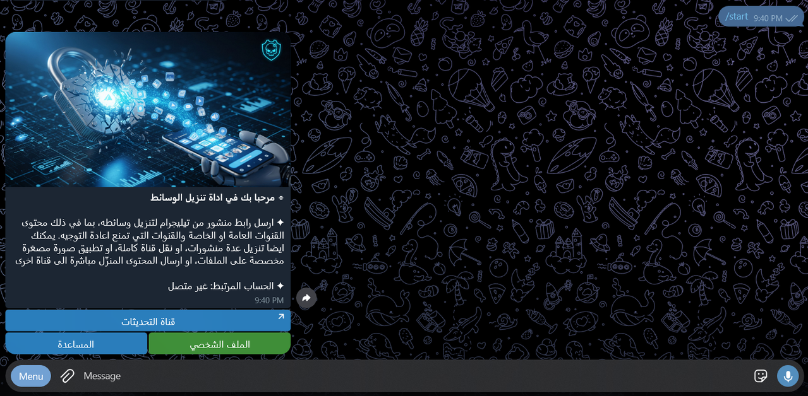

<div dir="rtl">

# RCD

[English](README.md) · **العربية**

بوت تيليجرام يحفظ المنشورات من القنوات والمجموعات، حتى التي تمنع إعادة التوجيه والحفظ.

ترسل إلى البوت رابط منشور فيعيده إليك: الفيديو أو الصورة أو الملف أو النص مع وصفه. ويمكنه أيضًا حفظ مجموعة متتالية من المنشورات، أو نسخ قناة كاملة، أو متابعة قناة وإرسال كل منشور جديد فيها. وتصل الملفات إلى محادثتك الخاصة أو إلى قناة تملكها.

جرّبه: [@Z1MRestrictedContentDLbot](https://t.me/Z1MRestrictedContentDLbot)



## ماذا يفعل

- يحفظ منشورًا واحدًا من رابطه، بما في ذلك الألبومات والتعليقات والوسائط المدفوعة
- يحفظ المنشورات بين رابطين، مع تصفيتها حسب النوع (فيديو، صور، صوت، ملفات، نصوص) وحسب المدة
- ينسخ قناة كاملة، ويتابع قناة ليرسل كل منشور جديد مرة واحدة وبالترتيب
- يقرأ المصادر الخاصة والمقيدة عبر حساب تيليجرام يربطه المستخدم بالبوت، والمصادر العامة عبر مجموعة من حسابات التحميل
- يقسم الملفات الأكبر من حد رفع البوت (2 غيغابايت) إلى أجزاء، أو يرفعها كاملة إلى قناة المستخدم عبر حسابه المميز (Premium)
- يحفظ كل مهمة في طابور لا يضيع عند إعادة التشغيل، وتستأنف من آخر منشور محفوظ
- يتيح للمستخدم اختيار طريقة التعامل مع الوصف (إبقاؤه، أو حذفه، أو حذف الروابط والمعرفات منه) وصورة مصغرة خاصة
- يمنح المالكين والمشرفين لوحة للاشتراكات والهدايا وقنوات الاشتراك الإجباري والرسائل الجماعية والسجلات وتصدير المستخدمين

[اقرأ كيف يعمل](docs/how-it-works.ar.md)

## الخطط

يحصل المستخدم المجاني على 25 تحميلًا يوميًا، إضافة إلى نقاط من الهدايا والإحالات. أما الاشتراك المميز فيلغي الحد اليومي، ويتيح نسخ القنوات ومتابعتها وطابورًا أكبر. ويُدفع داخل تيليجرام بنجوم تيليجرام (Stars)، أو يمنحه أحد المشرفين. [اقرأ عن الخطط والنقاط](docs/plans.ar.md)

## تشغيل نسختك الخاصة

تحتاج إلى رمز بوت من [@BotFather](https://t.me/BotFather)، ومعرّف التطبيق (API ID) ومفتاحه (API hash) من [my.telegram.org](https://my.telegram.org)، وقاعدة PostgreSQL. باستخدام Docker:

<div dir="ltr">

```bash
git clone https://github.com/Zaky1m/restricted-content-downloader.git
cd restricted-content-downloader
cp .env.example .env    # fill in the values
docker compose up -d
docker compose run --rm bot rcd pool-login    # sign in the accounts in POOL_PHONES
```

</div>

ومن دون Docker، ابنِ البرنامج بالأمر `cargo build --release` ثم شغّل `rcd serve` في مجلد فيه ملف `.env` مكتمل. ويتحقق الأمر `rcd check` من الإعداد قبل التشغيل الأول. [اقرأ دليل التشغيل](docs/deploy.ar.md)

## الترجمة

يتحدث البوت 30 لغة، ويختار كل مستخدم لغته. ولكل لغة ملف واحد في مجلد [`locales/`](locales)، فتصحيح سطر أو إضافة لغة لا يحتاج إلى تعديل في الكود. [اقرأ طريقة الترجمة](TRANSLATING.md)

## المساهمة

نرحب ببلاغات الأخطاء وطلبات الدمج. اقرأ [دليل المساهمة](CONTRIBUTING.md) لمعرفة طريقة البناء والاختبار، و[SECURITY.md](SECURITY.md) للإبلاغ عن ثغرة بشكل خاص.

## الترخيص

[MIT](LICENSE)

## المراجع

- [grammers](https://github.com/Lonami/grammers): عميل MTProto لتيليجرام بلغة Rust
- [SQLx](https://github.com/launchbadge/sqlx): الاتصال بـ PostgreSQL وترحيل قاعدة البيانات
- [Tokio](https://tokio.rs): بيئة التشغيل غير المتزامن
- [FFmpeg](https://ffmpeg.org): الصور المصغرة وبيانات الفيديو
- [واجهة تيليجرام البرمجية](https://core.telegram.org/api)

</div>
