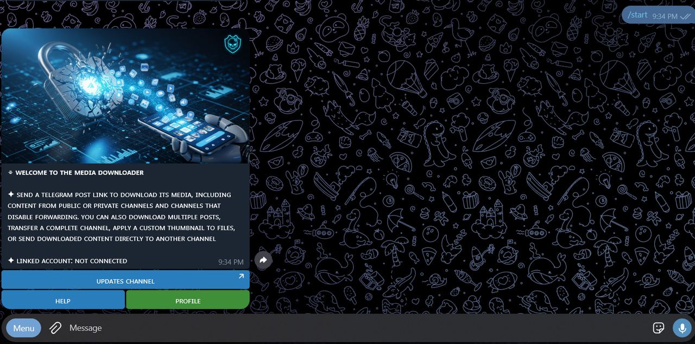
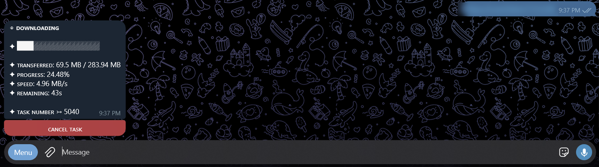

# RCD

**English** · [العربية](README.ar.md)

A Telegram bot that saves posts from channels and groups, including ones that
block forwarding and saving.

Send the bot a link to a post and it sends the post back to you: the video,
photo, file or text, with its caption. It can also save a range of posts, copy
a whole channel, or watch a channel and deliver every new post. Files can go
to your private chat or to a channel of your own.

Try it: [@Z1MRestrictedContentDLbot](https://t.me/Z1MRestrictedContentDLbot)





## What it does

- Saves a single post from a link, including albums, comments and paid media
- Saves a range of posts between two links, with filters by type (videos,
  photos, audio, files, text) and by duration
- Copies a whole channel, and watches a channel to deliver each new post once,
  in order
- Reads private and restricted sources through a Telegram account the user
  links to the bot, and public ones through a pool of download accounts
- Splits files larger than the bot's 2 GB upload limit into parts, or uploads
  them whole to the user's channel through their own Premium account
- Keeps every task in a queue that survives restarts and resumes from the last
  saved post
- Lets the user choose the caption (keep, remove, or remove links and
  mentions) and a custom thumbnail
- Gives owners and admins a panel for subscriptions, gifts, required channels,
  broadcasts, logs and user export

[Read how it works](docs/how-it-works.md)

## Plans

Free users get 25 downloads a day plus points from gifts and referrals. Premium
removes the daily limit and unlocks copying channels, watching channels and
larger queues. Premium is paid inside Telegram with Telegram Stars, or granted
by an admin. [Read about plans and points](docs/plans.md)

## Run your own

You need a bot token from [@BotFather](https://t.me/BotFather), an API ID and
hash from [my.telegram.org](https://my.telegram.org), and PostgreSQL. With
Docker:

```bash
git clone https://github.com/Zaky1m/restricted-content-downloader.git
cd restricted-content-downloader
cp .env.example .env    # fill in the values
docker compose up -d
docker compose run --rm bot rcd pool-login    # sign in the accounts in POOL_PHONES
```

Without Docker, build with `cargo build --release` and run `rcd serve` next to
a filled `.env`. `rcd check` validates the setup before the first start.
[Read the deployment guide](docs/deploy.md)

## Translations

The bot speaks 30 languages, and each user picks one. Every language is one
file in [`locales/`](locales). Fixing a line or adding a language needs no code
change. [Read how to translate](TRANSLATING.md)

## Contributing

Bug reports and pull requests are welcome. [Read the contributing
guide](CONTRIBUTING.md) for how to build and test, and
[SECURITY.md](SECURITY.md) to report a vulnerability privately.

## License

[MIT](LICENSE)

## References

- [grammers](https://github.com/Lonami/grammers): Telegram MTProto client in Rust
- [SQLx](https://github.com/launchbadge/sqlx): PostgreSQL access and migrations
- [Tokio](https://tokio.rs): async runtime
- [FFmpeg](https://ffmpeg.org): thumbnails and video details
- [Telegram API](https://core.telegram.org/api)
